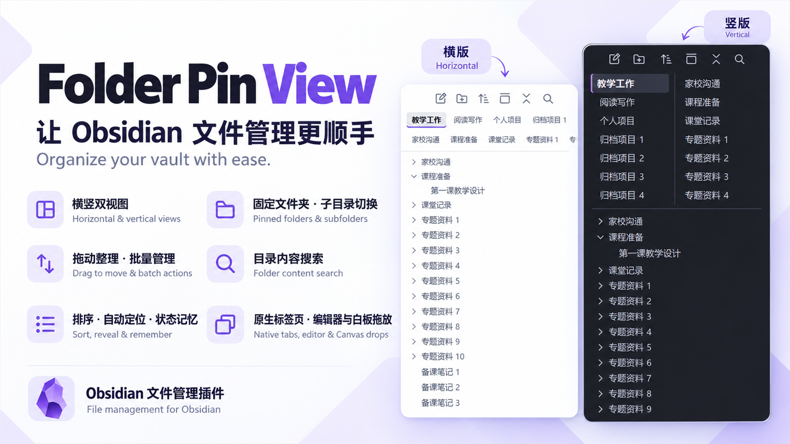

# Folder Pin View

固定常用文件夹，快速切换目录、拖动整理笔记，让 Obsidian 文件管理更顺手。

Pin your favorite folders, switch directories quickly, and organize notes with drag and drop in Obsidian.

**2.2.7** · Obsidian **1.13.0+** · [MIT](LICENSE)



## 功能 / Features

| 中文 | English |
| --- | --- |
| **固定与切换**：固定常用文件夹，快速浏览母目录和直接子目录，两级入口均可拖动排序。 | **Pin and navigate:** Keep favorite folders close, switch to direct subfolders, and reorder shortcuts. |
| **横竖双视图**：横版两排或竖版两列；竖版独立滚动、高度可调。 | **Two layouts:** Horizontal rows or vertical columns, with independent scrolling and a resizable folder area. |
| **拖动与批量管理**：拖动移动笔记，多选后批量打开、移动、删除，移动前检查冲突。 | **Drag and batch actions:** Move notes by dragging, or open, move, and delete selections with conflict checks. |
| **目录内容搜索**：在当前文件夹及下级目录中搜索笔记内容。 | **Folder content search:** Search notes within the selected folder and its descendants. |
| **原生操作**：Ctrl/Cmd 或中键打开新标签页；拖到编辑器生成链接，拖到白板添加卡片。 | **Native workflows:** Open new tabs with Ctrl/Cmd or middle-click; drop notes into editors for links or Canvas for cards. |
| **浏览状态记忆**：六种排序、可选自动定位、独立展开与滚动状态，中英双语与主题适配。 | **Remember your view:** Six sort modes, optional auto-reveal, saved expansion and scroll, bilingual UI, and theme support. |

## 安装与更新 / Install and update

从 [Releases](https://github.com/cimuyang/folder-pin-view/releases) 下载并解压安装包，将 `main.js`、`manifest.json`、`styles.css` 放入笔记库的 `.obsidian/plugins/folder-pin-view/`，然后启用插件。

Download and extract the package from [Releases](https://github.com/cimuyang/folder-pin-view/releases). Copy `main.js`, `manifest.json`, and `styles.css` into `.obsidian/plugins/folder-pin-view/` in your vault, then enable the plugin.

更新时先停用插件，替换上述三个文件，**保留 `data.json`**，再启用。  
To update, disable the plugin, replace the three files, **keep `data.json`**, then enable it again.

## 使用 / Usage

1. 右键文件夹选择“固定文件夹”；点击母文件夹显示其完整内容，点击子文件夹仅浏览对应目录。两级入口均可拖动排序。  
   Right-click a folder and choose **Pin folder**. Select a parent to browse all its contents or a child to browse that folder. Drag shortcuts to reorder them.
2. 在“设置 → 文件区 → 文件夹布局”切换横版、竖版；也可运行“切换文件夹布局”命令。竖版分隔线可拖动调整，双击复位。  
   Choose a layout in the plugin settings or run **Toggle folder layout**. Drag the vertical layout's separator to resize; double-click to reset.
3. 右键进入“多选模式”，点击选择，Shift 连选；右键批量操作，Esc 退出。点击放大镜搜索当前目录，在查询括号内输入关键词。  
   Enter **Select multiple items** from the context menu; click to select or Shift-click a range. Right-click for batch actions; Escape exits. Click the magnifier to search the current folder and type inside the query parentheses.

目录搜索需启用“搜索”核心插件；白板、数据库菜单取决于对应核心插件。  
Folder search requires the Search core plugin. Canvas and Bases menus require their respective core plugins.

## 开发与验证 / Development and validation

Node.js 24:

```sh
npm ci
npm run typecheck
npm test
npm run build
```

`npm run dev` 监听源码变化。可选浏览器检查：`node tests/browser-check.mjs`，需要 Playwright 和 Chromium；可设置 `FPV_PLAYWRIGHT_MODULE`、`FPV_BROWSER_EXECUTABLE` 使用已有安装。  
`npm run dev` watches source changes. Optional browser QA: `node tests/browser-check.mjs` requires Playwright and Chromium; use `FPV_PLAYWRIGHT_MODULE` and `FPV_BROWSER_EXECUTABLE` for existing installations.

类型检查、92 项回归测试、11 组浏览器检查及构建通过。浏览器预览使用演示数据；原生 Obsidian 桌面和手机触控仍待实测。  
Type checking, 92 regression tests, 11 browser checks, and the build pass. Browser previews use demo data; native Obsidian desktop and mobile touch validation is still pending.

## 隐私 / Privacy

无网络请求，无遥测。设置仅保存在当前笔记库的插件目录 `data.json` 中。  
No network requests or telemetry. Settings are stored only in the plugin's `data.json` within the current vault.

## 更新记录 / Changelog

历史条目整理自 [GitHub 发布说明 / GitHub Releases](https://github.com/cimuyang/folder-pin-view/releases)。

### 2.2.7 · 待发布 / Unreleased

- 新增竖版双列布局、独立滚动和高度调整；支持设置及命令切换，保留浏览状态。  
  Added vertical columns with separate scrolling, a resizable folder area, and layout switching that retains browsing state.
- 增强拖动移动：悬停预览子目录、边缘滚动、跨面板拖入及取消清理；精简栏目说明。  
  Improved moves with hover previews, edge scrolling, cross-pane drops, and cancellation cleanup; removed column captions.

### [2.2.6](https://github.com/cimuyang/folder-pin-view/releases/tag/2.2.6) · 2026-10-02

- 新增原生新标签页操作、独立多选模式、右键菜单扩展及编辑器／白板拖放。  
  Introduced native tab gestures, a dedicated selection mode, context-menu integrations, and editor/Canvas drops.
- 新增当前目录内容搜索，优化窄侧栏六按钮工具栏。  
  Added scoped content search and refined the six-button toolbar for narrow sidebars.

### [2.2.5](https://github.com/cimuyang/folder-pin-view/releases/tag/2.2.5) · 2026-09-30

- 新增可排序的子目录快捷栏，分别记忆母目录和子目录的浏览状态。  
  Added reorderable subfolder shortcuts with separate browsing state for parent and child folders.
- 修复右键批量移动，加入目标目录搜索，完善多窗口与异步操作同步。  
  Fixed batch context-menu moves, added destination search, and improved synchronization across panes and pending operations.

### [2.2.4](https://github.com/cimuyang/folder-pin-view/releases/tag/2.2.4) · 2026-09-25

- 新增文件、文件夹及多选项目的拖动移动，检查重名和目录循环，沿用链接更新。  
  Added drag moves for files, folders, and selections, with collision and cycle checks plus link-aware movement.
- 最低版本调整为 Obsidian 1.13.0；统一官方依赖源并完善构建检查。  
  Required Obsidian 1.13.0 and standardized dependency sources and build verification.

### [2.2.3](https://github.com/cimuyang/folder-pin-view/releases/tag/2.2.3) · 2026-09-25

- 修复重复删除，完善多选删除与父子项目去重。  
  Fixed repeated deletion and improved selection deletion without processing descendants twice.
- 改进新笔记标题编辑、中文输入法、弹出窗口和设置兼容性。  
  Refined note-title editing, Chinese input, pop-out windows, and settings compatibility.

### [2.2.2](https://github.com/cimuyang/folder-pin-view/releases/tag/2.2.2) · 2026-09-25

- 优化新建与命名：即时打开笔记、侧栏命名文件夹、定位新项目；避免并发重名和异步抢焦点。  
  Streamlined creation with immediate note opening, inline folder naming, item reveal, duplicate-name protection, and focus-safe completion.

### [2.2.1](https://github.com/cimuyang/folder-pin-view/releases/tag/2.2.1) · 2026-09-24

- 修复标签可见性和滚动复位；统一工具栏，加入六种排序、自动定位及独立浏览状态。  
  Fixed tab visibility and scroll resets; unified tools and added six sorting options, auto-reveal, and per-folder state.
- 完善双语界面、行内编辑、配置迁移及原生重命名／删除行为。  
  Improved localization, inline editing, settings migration, and native rename/delete handling.

### [2.2.0](https://github.com/cimuyang/folder-pin-view/releases/tag/2.2.0) · 2026-09-01

未附更新说明。 / No release notes were provided.

### [2.1.0](https://github.com/cimuyang/folder-pin-view/releases/tag/2.1.0) · 2026-09-01

未附更新说明。 / No release notes were provided.

### [2.0.0](https://github.com/cimuyang/folder-pin-view/releases/tag/2.0.0) · 2026-09-01

未附更新说明。 / No release notes were provided.

### [1.1.0](https://github.com/cimuyang/folder-pin-view/releases/tag/1.1.0) · 2026-09-01

未附更新说明。 / No release notes were provided.
